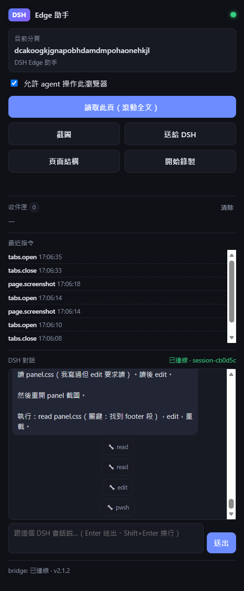
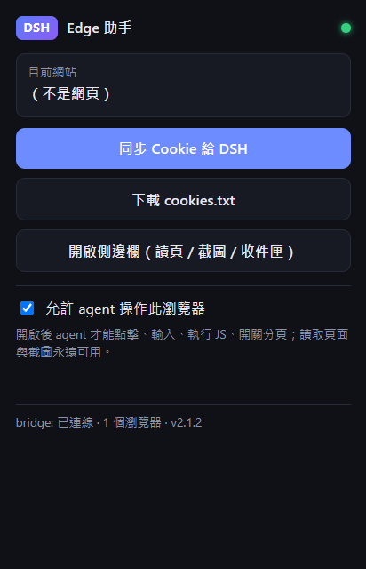

# DSH Bridge v2.1 — Edge 全能助手

[](LICENSE)
[](https://www.microsoft.com/edge)
[](extension/manifest.json)

<p align="center">
  
  &nbsp;&nbsp;
  
</p>

把 Edge 接到 DeepSeek Harness：不只匯出 cookie，還能讓我**讀頁面、截圖、操作瀏覽器、
管理分頁、查歷史書籤下載**。v2.1 起補上 Kimi 瀏覽器擴充同等級的能力：CDP 真實點擊／
打字、無障礙樹、可點元素清單、滾動全文、網路與 Console、iframe、側邊欄、劃詞、
操作錄製。全部走本機 `127.0.0.1:8765` 的 WebSocket 雙向通道。

v2.1.2 起側邊欄還能**直接跟這個 DSH 會話對話**（送指令、看回覆逐字輸出），
靠一個本地 DSH 插件 `dsh-browser-chat`（`dsh-plugin/`，只綁 `127.0.0.1:8766`）。

## 快速開始（開源版）

需求：Windows、Edge 114+、Python 3.10+（`aiohttp`）、Node 18+（只跑測試用）、
`yt-dlp` + `ffmpeg`（影片下載用，可選）。

```powershell
git clone <此 repo>
cd edge-dsh-bridge

# 1) 擴充：edge://extensions → 開啟「開發人員模式」→「載入解壓縮」
#    選擇 extension/ 資料夾
# 2) bridge：啟動本機 server（另開一個視窗）
python server\bridge_server.py
# 3) （可選）DSH 側邊欄對話插件：用 DSH 的 plugin_manager install_bundle
#    指向 dsh-plugin/ 這個資料夾
```

驗證：`python server\bridge.py health` 回 `{"status":"ok",...}`、
擴充 popup 燈變綠。

授權 MIT（見 [LICENSE](LICENSE)）；權限與安全說明見 [SECURITY.md](SECURITY.md)。

## 架構

```
┌────────────┐  ws://127.0.0.1:8765/ws  ┌──────────────┐
│ Edge 擴充  │ ◄──── cmd / result ────► │ bridge server│
│ (MV3)      │                          │ (aiohttp)    │
└─────┬──────┘                          └──────┬───────┘
      │ 側邊欄對話（http / sse :8766）          │ HTTP /cmd
      ▼                                        ▼
┌──────────────────┐                  agent / bridge.py CLI
│ DSH 插件          │
│ dsh-browser-chat │ ──► sessionController.prompt / session/event
└──────────────────┘     （就是你在 GUI 看到的同一個會話）
```

- 擴充啟動就建立 WS 長連線，閒置時用 20 秒 ping + 30 秒 alarm 維持／自動重連
- agent 用 `POST /cmd` 送指令，bridge 透過 WS 轉給擴充，等結果回傳（預設 25 秒逾時）
- 截圖由 bridge 自動存到 `data/screenshots/`
- 側邊欄對話不經 bridge：直接連 DSH 插件的 8766（插件只在 DSH host 內跑）

## 能力（指令集）

| 分類 | 指令 | 控制模式 |
| --- | --- | --- |
| 狀態 | `status` `tabs.groups` | ❌ 不需要 |
| 分頁 | `tabs.list` `tabs.active` | ❌ |
| 分頁 | `tabs.open` `tabs.close` `tabs.activate` `focus` `tabs.group` `tabs.ungroup` | ✅ 需要 |
| 頁面讀取 | `page.info` `page.text` `page.markdown` `page.links` `page.images` `page.html` `page.read` `page.ax` `page.controls` `page.wait` `page.waitFor` `page.screenshot` `page.pdf` | ❌ |
| 頁面操作 | `page.click` `page.type` `page.press` `page.hover` `page.select` `page.scroll` `page.eval` | ✅ 需要（CDP 真實事件） |
| 網路 | `network.start` `network.list` `network.clear` `network.stop` | ✅ 需要 |
| Console | `console.start` `console.get` `console.clear` `console.stop` | ✅ 需要 |
| Dialog | `dialog.list` `dialog.accept` `dialog.dismiss` | ✅ 需要 |
| Cookie | `cookies.get`（讀，可自動存檔） | ❌ |
| Cookie | `cookies.set`（寫入） | ✅ 需要 |
| 瀏覽器資料 | `history.search` `bookmarks.search` `downloads.list` | ❌ |
| 錄製 | `record.start` `record.stop` `record.status` | ✅ 需要 |
| 收件匣 | `inbox.push`（選取文字／頁面／連結丟給 agent） | ❌ |

> 讀取類（頁面文字／截圖／歷史／書籤／下載清單）永遠可用；
> 會改變瀏覽器狀態或執行任意 JS 的指令，必須在 popup 或側邊欄勾選
> **「允許 agent 操作此瀏覽器」**（控制模式）。

## 更新到 v2.1.1（重要）

> **2.1.1 健檢修正**：Edge 只剩背景進程（沒有任何視窗）時 `open` 會失敗
> （現在會自動開一個視窗）；`page.select` 找不到元素時回 `null`（現在給明確錯誤）；
> 截圖／PDF 不再無限累積（自動保留最近 200／100 個）。

這一版把 Kimi 瀏覽器擴充的能力對應過來：

- **CDP 真實操作**：`page.click` / `page.type` / `page.press` 走
  `Input.dispatchMouseEvent` / `Input.dispatchKeyEvent`，React / Vue 這類
  受控元件也點得動、打得進去（舊的 DOM click 仍可用 `--dom` 退回）。
- **元素截圖與整頁截圖**：`shot --selector` / `shot --full`。
- **無障礙樹與可點元素清單**：`ax`（頁面結構）、`controls`（可互動元素 +
  穩定 selector + 座標），對純文字 agent 特別有用。
- **滾動全文**：`read` 處理延遲載入、無限捲動、內部滾動容器、shadow DOM，
  長頁用 `--start` 續讀。
- **等待條件**：`waitfor --selector/--text/--url/--network-idle`。
- **網路 / Console / Dialog**：`network` / `console` / `dialog`。
- **iframe**：`controls` 預設掃描所有 frame 並標出 `frameId`；
  `click` / `type --frame <frameId>` 可操作框架內元素（`read` 讀主頁面）。
- **側邊欄**：popup 按「開啟側邊欄」，可讀頁、截圖、看收件匣。
- **劃詞右鍵**：選取文字 → 右鍵「把選取文字送給 DSH」。
- **操作錄製**：`record start` → 使用者操作 → `record stop` 取得步驟。
- **PDF / 分頁群組**：`pdf`、`group`。

新增權限：`debugger`、`sidePanel`、`tabGroups`、`webNavigation`、`contextMenus`。
Edge 重載時會再問一次權限，**要手動按一次重新載入**：

1. 開 `edge://extensions`
2. 找到 **DSH Edge Assistant** 卡片，按「**重新載入**」（🔄）
   - 版本應該變成 **2.1.0**
   - 若 Edge 提示需要新權限，選「允許／重新載入」
3. 點擴充圖示確認 popup 右上燈是**綠色**、底部顯示「bridge: 已連線 · … · v2.1.0」

> ⚠ `debugger` 權限會在 agent 實際操作時讓 Edge 顯示「正在偵錯此瀏覽器」的提示條
> （閒置 10 秒會自動 detach，提示條消失）。Kimi 擴充也是同樣機制。

## 啟動 bridge

**建議一次安裝「登入自動啟動」，之後開機就在跑，不用再管：**

```powershell
cd "edge-dsh-bridge\server"
powershell -ExecutionPolicy Bypass -File .\install-autostart.ps1
```

- 會在「啟動」資料夾放一個 `DSH Bridge Server.vbs`（免管理員權限），
  登入後用 `pythonw` 背景啟動守護程式 `bridge_daemon.py`
- 守護程式會顧著 server：掛掉自動重開（約 5 秒內）
- 移除：`install-autostart.ps1 -Remove`
- 想改用工作排程器：`install-autostart.ps1 -UseScheduledTask`

**臨時要它起來 / 懷疑它沒跑：**

```powershell
powershell -ExecutionPolicy Bypass -File .\ensure-bridge.ps1
powershell -ExecutionPolicy Bypass -File .\ensure-bridge.ps1 -Restart   # 強制重開
```

**前景手動跑（看即時 log 用）：**

```powershell
powershell -ExecutionPolicy Bypass -File .\start-bridge.ps1
```

依賴：`aiohttp`（已安裝於 DSH 的 Python 環境）。
常駐時的日誌在 `data/bridge.log`。

## Popup 操作流程

### 介面（由上到下）

```
DSH  Edge 助手                    ●   ← 綠=已連 bridge / 灰=未連線
┌─────────────────────────────────────┐
│ 目前網站   www.bilibili.com          │
│            哔哩哔哩 (゜-゜)つロ …      │
├─────────────────────────────────────┤
│ [ 同步 Cookie 給 DSH ]              │  ← 把本站 cookie 送給 agent
│ [ 下載 cookies.txt ]                │  ← 不靠 bridge，直接存檔
│ [ 開啟側邊欄（讀頁 / 截圖 / 收件匣）]│  ← 側邊欄面板
├─────────────────────────────────────┤
│ ☐ 允許 agent 操作此瀏覽器            │  ← 控制模式開關
│   開啟後 agent 才能點擊、輸入、      │
│   執行 JS、開關分頁、錄製；讀取頁面  │
│   與截圖永遠可用。                  │
└─────────────────────────────────────┘
  已同步 30 個 cookie → …               ← 操作結果訊息
  bridge: 已連線 · 1 個瀏覽器 · v2.1.0  ← 底部狀態
```

### 流程 A：讓 agent 讀取／截圖目前頁面（最常用）

1. 切到目標網頁
2. 點工具列的 **DSH Edge Assistant** 圖示
3. 確認右上燈是**綠色**
4. 關掉 popup，直接跟 agent 說要做什麼（不用按任何按鈕）

### 流程 B：讓 agent 操作瀏覽器（點擊／輸入／開分頁）

1. 點圖示 → 勾選 **「允許 agent 操作此瀏覽器」**
2. 訊息出現「控制模式已開啟（agent 可操作瀏覽器）」
3. 跟 agent 說要做什麼
4. **用完建議取消勾選**，恢復唯讀

### 流程 C：把登入 cookie 交給 agent（例如下載 4K）

1. 切到已登入的網站（如 `bilibili.com`）
2. 點圖示 → 按「**同步 Cookie 給 DSH**」
3. 看到「已同步 N 個 cookie → `data\cookies\<網域>.txt`」即成功
4. 告訴 agent「同步好了」

### 流程 D：下載 cookies.txt 到本機（不用 bridge）

1. 點圖示 → 按「**下載 cookies.txt**」
2. 另存新檔對話框 → 選路徑（檔名如 `dsh-cookies-bilibili.com.txt`）
3. 把路徑給 agent，讓它用 `yt-dlp --cookies <路徑>` 使用

### 狀態燈

| 燈號 | 意義 | 處理 |
| --- | --- | --- |
| 🟢 綠 | WebSocket 已連上 bridge | 可接收指令 |
| ⚪ 灰 | 未連線 | 跑 `server\ensure-bridge.ps1`（沒跑就背景起來）；平常靠 `install-autostart.ps1` 就不會再遇到 |
| 底部「bridge: 未連線」 | HTTP 也連不到 | 確認 bridge 有在跑、8765 沒被占用 |

## 側邊欄 DSH 對話（v2.1.2）

側邊欄（popup 按「開啟側邊欄」）多了一個「DSH 對話」區塊：

- 可以直接對**最近有活動的會話**（＝你正在看的這個）下指令
- 我的回覆會在那裡**逐字出現**（串流）
- 你在 GUI 打的訊息也會同步過來

它靠本地插件 `dsh-browser-chat`（`dsh-plugin/`，只綁 `127.0.0.1:8766`）：
`sessionController.prompt` 送訊息、`session/event` 與 `agent/assistant-stream` 推回覆。

```powershell
# 檢查插件是否活著
curl http://127.0.0.1:8766/health
curl http://127.0.0.1:8766/sessions
```

> 側邊欄送出的訊息會真的進入會話（等於你多了一個輸入端）。
> 改插件程式碼後要**重啟 DSH** 才會載入新版；只重載擴充不會影響插件。

## CLI 用法

```powershell
$cli = "server\bridge.py"

python $cli health                 # bridge 狀態 + 已連線瀏覽器
python $cli status                 # 擴充狀態（版本、控制模式、目前分頁）
python $cli tabs                   # 所有分頁
python $cli active                 # 目前分頁
python $cli open "https://example.com"
python $cli close 123              # 關閉分頁
python $cli info                   # 頁面資訊（title/url/選取文字/字數）
python $cli text --max 5000        # 頁面純文字
python $cli markdown               # 頁面轉 Markdown
python $cli links --limit 50       # 頁面連結
python $cli images                 # 頁面圖片
python $cli html --max 2000        # HTML 原始碼
python $cli shot --out shot.png    # 截圖（bridge 已存一份）
python $cli click "#submit"        # 點擊元素（控制模式）
python $cli type "#q" "hello"      # 輸入文字（控制模式）
python $cli scroll 1200            # 捲動（控制模式）
python $cli eval "document.title"  # 執行 JS（控制模式）
python $cli history "關鍵字"        # 搜尋歷史
python $cli bookmarks "關鍵字"      # 搜尋書籤
python $cli downloads              # 最近下載
python $cli cookies                 # 自動用「目前分頁」的網域（含父網域登入 cookie）
python $cli cookies bilibili.com    # 指定網域
python $cli cookies --tab 123       # 從指定分頁推導網域
python $cli getcookie               # 自動存到 data/cookies/<host>.txt
python $cli getcookie bilibili.com "D:\temp\bili.txt"   # 指定網域＋輸出路徑

# --- v2.1 新能力 ---
python $cli read --max 50000           # 滾動收集全文（處理延遲載入／無限捲動）
python $cli read --start 50000         # 續讀（看 stderr 的 nextStart）
python $cli ax --max 400               # 無障礙樹（頁面結構）
python $cli controls --limit 40        # 可互動元素 + 穩定 selector + 座標（含 iframe）
python $cli waitfor --selector "#done" --timeout 15000
python $cli waitfor --text "載入完成"
python $cli waitfor --network-idle
python $cli shot --selector ".card" --out card.png   # 元素截圖
python $cli shot --full --out full.png               # 整頁截圖
python $cli click "#submit"            # CDP 真實滑鼠（預設）
python $cli click "#submit" --dom      # 退回舊的 DOM click
python $cli type "#q" "hello" --submit --delay 30    # CDP 鍵盤輸入
python $cli press "Control+Enter"
python $cli hover ".menu"
python $cli select "#city" "台北"
python $cli click "#inside" --frame 3  # iframe 內元素（frameId 由 controls 查）
python $cli network start              # 開始記錄請求
python $cli network list --max 30
python $cli console get --max 30
python $cli dialog accept --text "確定"
python $cli pdf --out page.pdf
python $cli group --title "登入任務" --tabs 123,124
python $cli groups
python $cli record start               # 使用者操作 → record stop 取得步驟
python $cli inbox                      # 領取右鍵選單／側邊欄送來的內容

# 通用指令（自訂 args）
# PowerShell 會吃掉 inline JSON 的雙引號，建議把 args 寫成檔案
# （Set-Content -Encoding utf8 帶 BOM 也能讀，v2.0.1 起用 utf-8-sig）：
'{"max":1000}' | Set-Content -Encoding utf8 args.json
python $cli cmd page.text --args-file args.json
```

> 所有 `page.*` 便捷指令都支援 **`--tab <ID>`** 指定分頁（省略＝目前作用中的分頁）；
> 分頁 ID 用 `python $cli tabs` 查。
>
> CLI 的輸出在被管線／agent 擷取時是 **UTF-8**（終端則沿用系統編碼），
> 所以 `text` / `markdown` 遇到 emoji 不會再 traceback。

## 側邊欄、右鍵、錄製

- **側邊欄**：popup 按「開啟側邊欄」。面板顯示連線狀態、目前分頁、控制模式，
  並有「讀取此頁」「截圖」「送給 DSH」「頁面結構」「開始／停止錄製」，
  下方是收件匣與最近指令。
- **右鍵選單**：選取文字 → 右鍵「把選取文字送給 DSH」；
  頁面任意處右鍵「把目前頁面送給 DSH」；連結右鍵「把連結送給 DSH」。
  內容會進 bridge 的 `/inbox`，agent 用 `python bridge.py inbox` 領取。
- **操作錄製**：`python bridge.py record start` → 在頁面上操作 →
  `python bridge.py record stop`，會拿到 click／input／select／submit／navigate
  步驟（含 selector、文字、座標）。

## 離線測試（不需要開 Edge）

```powershell
node test\extension-logic.test.js
```

用 Node 的 vm 把 `background.js` 載進 stub 的 `chrome.*` 環境，驗證 cookie 收集、
組合鍵解析、AX 樹壓縮、錄製合併、等待條件、收件匣佇列等純邏輯。
改完擴充先跑這個，再按重新載入。

## Cookie 與 yt-dlp

**在目標網站的分頁上（已登入），不用告訴 agent 網域：**

```powershell
python server\bridge.py cookies          # 看摘要（含登入判斷）
python server\bridge.py getcookie        # → data\cookies\<host>.txt
yt-dlp --cookies "data\cookies\www.bilibili.com.txt" -F "https://www.bilibili.com/video/BV..."
```

- 省略網域時**自動用目前分頁**（或用 `--tab <ID>` 指定分頁）；省略輸出路徑時
  自動存到 `data/cookies/<host>.txt`
- 會自動補父網域：站在 `space.bilibili.com` 也會帶上 `.bilibili.com` 的 cookie
- 輸出會給登入參考（**啟發式**，靠 cookie 名稱判斷，不是 100% 準）：
  - `loggedIn`：有沒有 SESSDATA／SESSIONID／JSESSIONID／csrftoken… 這類強 session cookie
  - `loginHints`：命中的強 session cookie 名稱
  - `sessionCookies`：較寬鬆的 session-like 名稱清單

> 指定網域也可以（不開著該頁也能抓）：
> `python server\bridge.py getcookie www.bilibili.com "D:\temp\bili-cookies.txt"`

（`cookies.get` 由擴充用 `chrome.cookies` 取得明文，繞過 Edge 的 App-Bound Encryption。）

## 多平台下載腳本（fetch-media.py）

一支腳本自動判斷「影片還是圖片」：

```powershell
$fm = "scripts\fetch-media.py"

python $fm "https://www.bilibili.com/video/BV..."     # 影片（yt-dlp，最高畫質）
python $fm "https://www.youtube.com/watch?v=..."      # 影片（可到 4K）
python $fm "https://x.com/user/status/123"            # 推文影片
python $fm "https://www.pixiv.net/artworks/150302261" # 圖片（多頁全抓）
python $fm "https://some.site/gallery"                # 其他網站：抓頁面大圖
python $fm "<url>" --dry-run                          # 只判斷/列出，不下載
python $fm "<url>" --mode image --max-images 30       # 強制圖片模式
python $fm "<url>" --out "D:\downloads"               # 指定輸出資料夾
```

判斷邏輯：

1. `pixiv.net` → Pixiv 模式：官方 ajax 取原圖，依 `pageCount` 抓 `_p0.._pN`
2. 其他網域 → 先試 yt-dlp；支援 → 影片模式（`bv*+ba/b` 合併成 mp4）
3. yt-dlp 不支援 → 開頁用 `page.images` 抓大圖（≥300px；Twitter 的
   `?name=small` 會自動改成 `orig`）

- cookie 自動從 Edge 目前分頁抓（或用 `--cookie-host` 指定、或沿用
  `data/cookies/<host>.txt`）
- 輸出歸類到 `D:\剪輯\DSH Edge Assistant\影片\<平台>\` 或 `圖片\<平台>\`
  （`DSH_MEDIA_ROOT` 環境變數可改根目錄；`--out` 可指定單次路徑；
  沒有 D 槽時退回 `downloads/`）
- 需要 bridge + Edge（cookie／圖片模式）；影片模式只要有 cookie 檔就能跑

## 安全

- bridge 只綁 `127.0.0.1`，外部無法連入；但本機任何程式都能呼叫 `/cmd`。
- **控制模式**是唯一的寫入閘門：不勾選時，agent 只能讀、不能改瀏覽器狀態。
- 收到的 cookie 明文存在 `data/cookies/`（含 `SESSDATA` 等登入憑證），
  不要上傳、分享或提交到 git；不用時刪除整個 `data/` 即可。
- `page.eval` 在頁面「主世界（MAIN world）」執行（MV3 隔離世界禁止 `eval`），
  可在沒有 CSP 的頁面求值任意 JS，只在你信任的環境使用。
- 裝了自動啟動後，登入 Windows 會有一個隱藏的 `pythonw.exe`（守護程式）
  常駐並開著 `127.0.0.1:8765`；不想要就 `install-autostart.ps1 -Remove`。
- **控制模式存在 `chrome.storage.local`，Edge 重啟後仍然開著**；用完記得回去取消勾選。

## 疑難排解

| 症狀 | 處理 |
| --- | --- |
| popup 燈灰色 | bridge 沒跑：`powershell -File server\ensure-bridge.ps1`（會自動背景起來）；平常靠 `install-autostart.ps1` 就不會再遇到 |
| popup 一直是「連線中…」 | `ensure-bridge.ps1 -Restart`；再看 `data\bridge.log` |
| 「控制模式未開啟」 | popup 勾「允許 agent 操作此瀏覽器」 |
| 「沒有作用中的分頁」 | 切到實際網頁（`edge://` 不適用） |
| 「找不到元素」 | selector 不對；先用 `python bridge.py controls` 或 `python bridge.py eval "document.querySelectorAll('button').length"` 檢查 |
| 截圖失敗 | 分頁要被看到（不能最小化），必要時 Edge 視窗到前景 |
| 出現「正在偵錯此瀏覽器」提示條 | `debugger` 權限的正常提示；agent 操作時出現，閒置 10 秒自動 detach 後消失 |
| `無法 attach debugger` | 同一分頁已開著 DevTools（F12）；關掉 DevTools 再試 |
| 側邊欄打不開 | 要在 popup 裡按（需要使用者手勢）；Edge 版本需 ≥ 114 |
| 錄製不到步驟 | content script 只在頁面載入後注入；重新整理頁面後再按「開始錄製」 |
| 元素截圖一片黑 | 元素在視窗外或 `display:none`；先用 `controls` 看它的 `visible` |
| `No current window` | 舊版才有；2.1.1 起 `open` 在 Edge 沒有視窗時會自動開一個（仍失敗就手動開 Edge 視窗） |
| 截圖／PDF 越積越多 | 2.1.1 起自動清理：截圖保留最近 200 張、PDF 保留最近 100 個 |
| 側邊欄「DSH 對話」顯示未連線 | DSH 插件沒跑：`curl http://127.0.0.1:8766/health`；沒回應就重啟 DSH（或重裝 bundle） |
| 對話看得到訊息但 assistant 文字是空的 | 插件是舊版（textOf 太嚴格）；重啟 DSH 載入 1.0.1 |
| 側邊欄訊息送不出去 | 確認插件在跑且 `/current` 有 sessionId；`curl http://127.0.0.1:8766/current` |
| `fetch-media.py` 判斷成圖片卻沒下載 | 頁面圖太小（<300px）或延遲載入；換 `--mode image --max-images 30`，或先滑到圖片再跑 |
| `fetch-media.py` 影片下載失敗 | 先 `yt-dlp -F <url>` 看是不是需要登入；確認 `data/cookies/<host>.txt` 存在且夠新 |
| cookie 只有 3 個、沒有 `SESSDATA` | 舊版 bug（只查 `www.bilibili.com`、漏掉 `.bilibili.com` 的登入 cookie）；更新擴充到 2.0.1 或直接用新版 CLI，再用 `python bridge.py cookies www.bilibili.com` 確認清單 |
| `UnicodeEncodeError: 'gbk' codec ...` | 舊版 CLI 在 GBK 主控台遇到 emoji 會炸；v2.0.1 已改成管道輸出 UTF-8，重跑即可 |
| `JSONDecodeError: Unexpected UTF-8 BOM` | 舊版讀 `--args-file` 不吃 BOM；v2.0.1 已用 `utf-8-sig` 讀取 |
| 重新載入後仍連不上 | 到 `edge://extensions` 點「檢查視圖 → service worker」看 console 錯誤 |

## 檔案結構

```
edge-dsh-bridge/
├─ extension/            # Edge 擴充（載入／重新載入這個資料夾）
│  ├─ manifest.json      v2.1.2（含 debugger / sidePanel / tabGroups…）
│  ├─ background.js      WS 通道 + CDP 指令層 + 錄製 + 收件匣
│  ├─ popup.html/js/css  連線狀態、cookie 同步、控制模式、開側邊欄
│  ├─ panel.html/js/css  側邊欄（讀頁 / 截圖 / 收件匣 / 錄製 / DSH 對話）
│  ├─ content/recorder.js  操作錄製 content script
│  └─ icons/
├─ dsh-plugin/           # DSH 插件 dsh-browser-chat（側邊欄對話橋，127.0.0.1:8766）
│  ├─ index.js           sessionController.prompt / session/event → SSE
│  ├─ cordis.patch.yml
│  ├─ locale/en.json / zh.json
│  └─ icon.svg
├─ server/
│  ├─ bridge_server.py   aiohttp：HTTP + WebSocket + /inbox
│  ├─ bridge.py          CLI（health / cmd / 便捷指令 / v2.1 新指令）
│  ├─ bridge_daemon.py   常駐守護（server 掛掉自動重開）
│  ├─ ensure-bridge.ps1  沒跑就背景起來（可 -Restart）
│  ├─ install-autostart.ps1  登入自動啟動（可 -Remove）
│  └─ start-bridge.ps1   前景手動啟動（看即時 log）
├─ scripts/fetch-media.py  多平台下載（影片/圖片自動判斷）
├─ test/extension-logic.test.js  擴充邏輯離線測試（不需要 Edge）
├─ data/                 cookies / screenshots / pdfs / inbox.json / bridge.log
└─ make_icons.py
```
